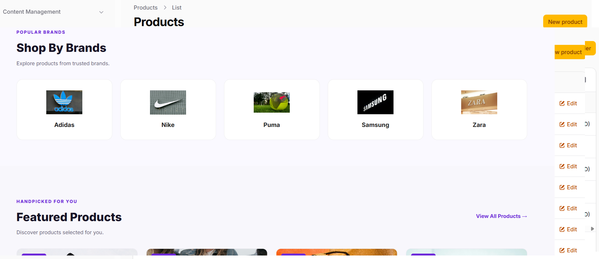
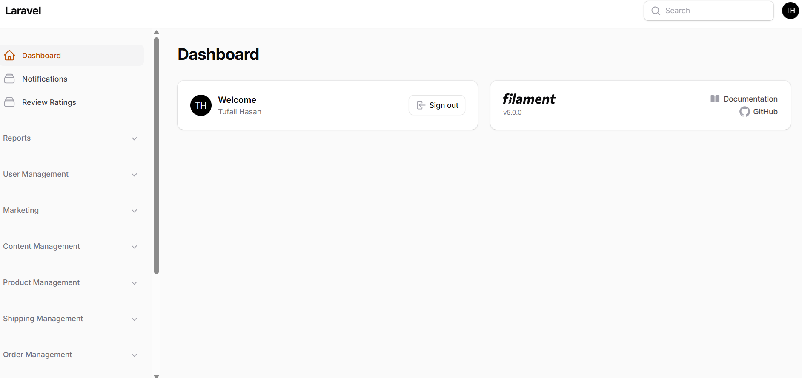
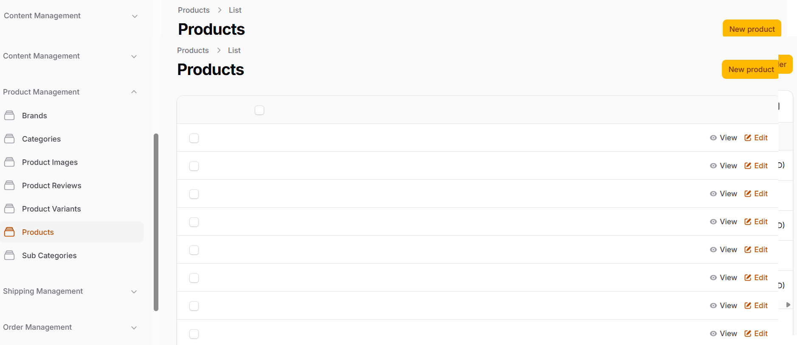
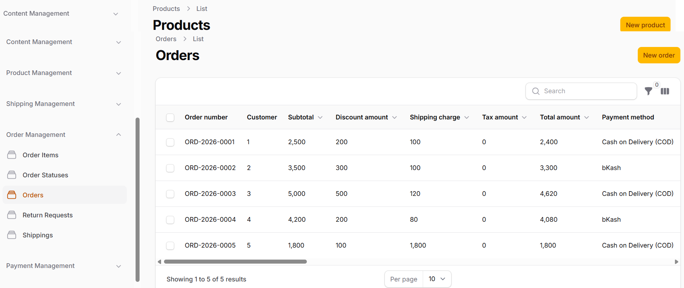
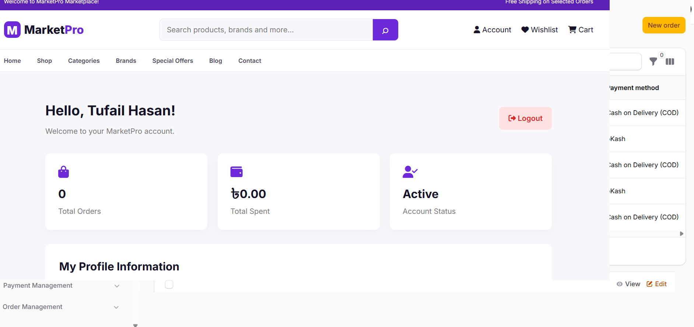

# MarketPro – Smart Multi-Vendor eCommerce Management System

A modern, feature-rich multi-vendor eCommerce management system built with Laravel 12 and Filament 5, featuring a premium online marketplace frontend.

## Project Overview

**Project Name:** Smart Multi-Vendor eCommerce Management System  
**Website Brand:** MarketPro  
**Tagline:** Premium Online Marketplace

MarketPro is a multi-vendor eCommerce platform designed to manage vendors, products, customers, orders, payments, shipping, and other marketplace operations through an administrative dashboard.

## Technologies Used

- PHP 8.2
- Laravel 12
- Filament 5
- MySQL / MariaDB
- HTML5
- CSS3
- JavaScript
- Blade Template Engine
- Vite

## Main Features

### Admin Panel
- Admin Dashboard
- User Management
- Customer Management
- Vendor Management
- Vendor Verification
- Product Management
- Category Management
- Brand Management
- Order Management
- Shipping Management
- Payment Management
- Coupon and Discount Management
- Website Content Management
- Reports and Settings

### Frontend – MarketPro
- Modern Homepage
- Product Listings
- Product Details
- Featured Products
- Latest Products
- Category Browsing
- Brand Browsing
- Product Search and Filtering
- Customer Registration and Login
- Shopping Cart
- Customer Order History
- Contact Page
- About Us Page
- FAQ Page

## Installation Guide

### 1. Clone Repository

```bash
git clone https://github.com/Tufail-Hasan/Smart-Multi_Vendor-eCommerce-Management-System.git
```

### 2. Navigate to Project

```bash
cd Smart-Multi_Vendor-eCommerce-Management-System
```

### 3. Install PHP Dependencies

```bash
composer install
```

### 4. Create Environment File

```bash
copy .env.example .env
```

### 5. Generate Application Key

```bash
php artisan key:generate
```

### 6. Configure Database

Create a MySQL database and update the database credentials in your `.env` file.

### 7. Run Migrations

```bash
php artisan migrate
```

### 8. Create Storage Link

```bash
php artisan storage:link
```

### 9. Install Frontend Dependencies

```bash
npm install
```

### 10. Run Development Server

```bash
npm run dev
```

Open another terminal:

```bash
php artisan serve
```

Visit:

`http://127.0.0.1:8000`

## Developer

**GitHub:** Tufail-Hasan

## Project Status

Under Development.

## License

This project is developed for educational and portfolio purposes.

## Project Screenshots

### 1. MarketPro Homepage


### Homepage - Middle


### Homepage - Bottom


### 2. Admin Dashboard



### 3. Product Management



### 4. Order Management



### 5. Customer Dashboard


